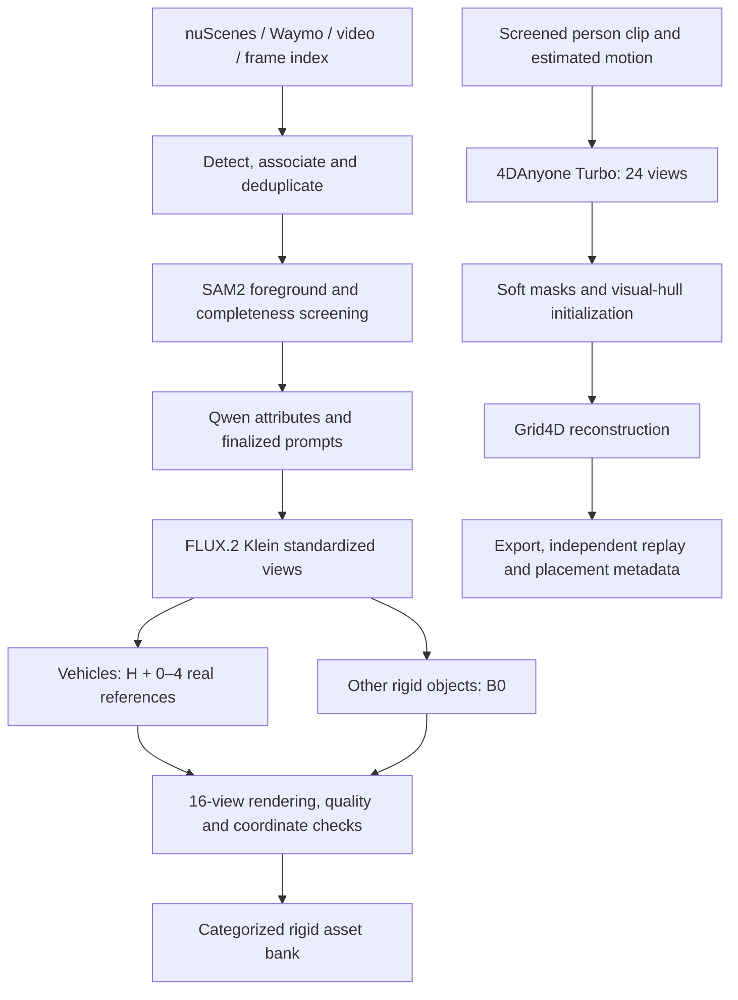

<div align="center">

# DriveLab

**Scene and video inputs → reusable rigid and dynamic Gaussian assets**

[Quick start](#quick-start) · [Rigid pipeline](docs/RIGID.md) · [Human pipeline](human/README.md) · [Installation](docs/INSTALL.md) · [Asset format](docs/ASSETS.md)

</div>

DriveLab constructs reusable assets from driving imagery. This repository brings together the current rigid-asset workflow and the human reconstruction workflow, including input preparation, generation, quality checks, provenance, export, and playback metadata.

The entry points are configurable by scene or video. There is **no fixed 1,000-asset generation target**. Model checkpoints, datasets, generated assets, and credentials are supplied separately.

## What is included?

| Pipeline | Input | Reconstruction | Delivery |
| :-- | :-- | :-- | :-- |
| **Rigid vehicles — H** | Segmented observation, FLUX views, 0–4 screened real references | ReconViaGen / TRELLIS-VGGT | Canonical 3D Gaussian PLY, dimensions, source and quality records |
| **Other rigid objects — B0** | Segmented observation and FLUX views | Original TRELLIS image / multi-image path | Same rigid package contract |
| **Dynamic humans** | Screened person clip, estimated motion, skeletons and cameras | 4DAnyone Turbo → Grid4D | Dynamic Gaussian NPZ, continuous runtime, cameras, motion and placement metadata |

Vehicle reference selection prefers 3–4 usable images. If only 2, 1, or 0 pass the checks, H uses that amount. Images are not duplicated to fill a quota. Small, heavily occluded, truncated or inconsistent observations are screened before generation.

## Pipeline overview



## Supported inputs

| Input | Rigid assets | Human assets |
| :-- | :-- | :-- |
| nuScenes scenes | Camera images and metadata | Native camera/track intake, cropping, segmentation and estimated motion |
| Waymo scenes | Uncompressed camera TFRecords, calibration and RGB | Screened G0 person packets / candidate CSV |
| Local video | Decode to a timestamped frame index | Requires a screened person/motion packet; no raw-video-to-approved-human wrapper is claimed |
| Online video URL | Download with yt-dlp, then the local-video path | Same human input boundary as above |
| Custom dataset | Provide the documented scene JSON contract | Provide the documented person packet contract |

Video inputs do not acquire invented camera calibration or metric ground truth. Edited videos should be split into continuous shots before processing. Visual association reduces duplicates within a scene; it does not certify global physical identity across unrelated videos or scenes.

## Quick start

### 1. Prepare the environments and checkpoints

```bash
git clone https://github.com/jincenou/DriveLab.git
cd DriveLab
```

Follow [Installation](docs/INSTALL.md). FLUX, TRELLIS, rendering and human reconstruction use separate Python environments because their CUDA and package requirements differ. The observed environment versions are recorded in [`environments/`](environments/).

### 2. Configure a rigid run

```bash
cp configs/pipeline.example.yaml configs/pipeline.local.yaml
# Set the source, run directory, output library and GPU list.
# Export the model and interpreter variables listed in docs/INSTALL.md.

"$RIGID_PYTHON" -m asset_extraction.run \
  --config configs/pipeline.local.yaml \
  --source nuscenes --input "$NUSCENES_ROOT" --scene-ids scene-0001
```

Other inputs use the same entry point:

```bash
# A Waymo segment; set source.python if its protobuf package lives in another environment.
"$RIGID_PYTHON" -m asset_extraction.run \
  --config configs/pipeline.local.yaml --source waymo --input /data/segment.tfrecord

# Local clip.
"$RIGID_PYTHON" -m asset_extraction.run \
  --config configs/pipeline.local.yaml --source video --input /data/clip.mp4

# A supported public video URL. Access to the source site is still required.
"$RIGID_PYTHON" -m asset_extraction.run \
  --config configs/pipeline.local.yaml --source video --input 'https://example.org/clip.mp4'
```

Choose a **new `run_dir` for a different source or recipe**. Reusing the same configuration resumes completed chunks. `--prepare-only` stops after source indexing; `--handoff-only` stops after input filtering and the FLUX manifest. `chunk_size` controls the work window, not the total number of assets. By default every eligible candidate in the selected scenes is processed.

### 3. Run human reconstruction

Configure [`human/config/runtime.example.json`](human/config/runtime.example.json), then follow [the human guide](human/README.md) for source intake, pilot reconstruction, validation and batch execution.

```bash
export HUMAN_RUNTIME_CONFIG="$PWD/human/config/runtime.local.json"
export HUMAN_RUN_ROOT=/data/runs/human_scene
export HUMAN_ASSET_ROOT=/data/asset_library/human
python scripts/configure_human.py "$HUMAN_RUNTIME_CONFIG" --apply
cd human
python run.py doctor
```

Human reconstruction retains the current **32,999 + 15,000 + 5,000 = 52,999 optimization updates**. Integration into this repository does not reduce the training schedule or convert technical completion into a visual quality approval.

## Outputs

```text
asset_library/
├── manifests/asset_library_rigid.json
├── rigid/
│   ├── car/H_<dataset>_<id>/
│   ├── truck/H_<dataset>_<id>/
│   ├── traffic_sign/B0_<dataset>_<id>/
│   └── _review/<category>/<route>_<dataset>_<id>/
└── human/
    ├── drivelab_asset.json
    └── <identity>/
```

A rigid package includes `asset.ply`, `asset.json`, `placement.json`, `source_camera.json`, source/reference images, quality evidence and a checksum manifest. A human package includes `asset_4dgs.npz`, its continuous runtime, cameras, source motion, placement transforms, validation records and one five-column `demo.mp4`.

See [the asset contract](docs/ASSETS.md) before insertion. A source camera is provenance, **not a target-scene insertion pose**. Scales and human motion are estimates; target trajectories are supplied by the downstream scene application.

## Quality and execution

- GroundingDINO, association, SAM2 and visual checks screen input candidates; duplicates and fragments are filtered before generation.
- The FLUX JSON contract remains `scene_id`, `obj_id`, `category`, `image_path`, `prompts`. Routing and real-view evidence are separate sidecars.
- Asynchronous OpenAI SDK calls use `client.chat.completions.create`, forced JSON output and schema validation.
- GPU workers use free-memory admission and shared lease files. Other GPU jobs are not stopped. Choose a common `DRIVELAB_GPU_LOCK_DIR` across cooperating controllers.
- Rigid quality states are `keep`, `review`, and `reject`. Review items are separate from the usable bank. Otherwise usable vehicles with only source-identity variations are retained with that variation recorded.
- Rejected generated outputs can be retired after their decisions and hashes are recorded. Original dataset files are never deleted by the new runner.
- Human technical replay, appearance review, contact quality and insertion eligibility are separate records. Consumers must honor `skip_insertion`.

## Repository layout

```text
asset_extraction/   Rigid extraction, source adapters, generation, audit and publication
nuscenes/          Shared handoff/filter/routing utilities (historical module name)
configs/           Portable rigid configuration examples
human/             Human intake, 4DAnyone/Grid4D workflow, playback and tests
vendor/            Rigid model runtime sources used by H and B0
scripts/           VLM startup and explicit human-resource binding
environments/      Observed dependency versions for the isolated runtimes
tests/             Rigid contract, scheduling and export checks
docs/              Setup, protocols, asset contracts and validation scope
```

## Tests and validation

```bash
python -m pytest -q tests
(cd human && python -m unittest discover -s tests -v)
```

The current [vehicle diagnostic table](docs/VEHICLE_METRICS.md) records its actual hardware and matched-source sample coverage.

CPU tests cover contracts and numerical helpers; they do not replace GPU reconstruction or visual review. See [validation scope](docs/VALIDATION.md) for what was actually exercised during this integration.

## Acknowledgments and licensing

This workflow uses GroundingDINO, SAM2, Qwen3-VL, FLUX.2 Klein, TRELLIS, ReconViaGen, 4DAnyone, GVHMR, RIFE and Grid4D. Upstream code and model licenses remain applicable. See [third-party notices](THIRD_PARTY_NOTICES.md) and the [human notices](human/THIRD_PARTY_NOTICES.md). Dataset access and model checkpoints are not redistributed here.
